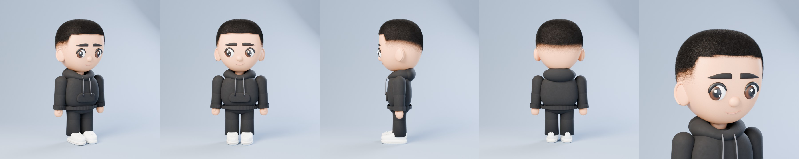

# hero-aipollon — главный герой канала

Модель по референсу mike от 26.10.2026: главный — `reference-v2.png` (второе фото, «работай по нему»), первое
`reference.png` оставлено для истории. Чиби-парень с большой головой-«яйцом», короткий чёрный фейд (кант на лбу,
на висках плавный переход к коже), большие карие глаза, густые брови, чёрное худи с карманом-кенгуру и серыми
шнурками, широкие прямые чёрные штаны, белые кроссовки в духе Air Force 1 (толстая подошва с канавкой, перфорация
на носке, без логотипа). Сделана нами из кода, лицензия CC0.



| файл | что это |
|---|---|
| `../../../../blender/library/hero.py` | **источник**: модель кодом для Blender (позы, ходьба, сидя) |
| `hero-aipollon.glb` | та же модель файлом (для KINEMA / three.js, других программ) |
| `preview.jpg` | превью: 3/4, спереди, сбоку, сзади, лицо (Cycles) |
| `reference-v2.png` | референс, по которому сверена модель (второе фото от mike) |
| `reference.png` | первое фото от mike (старый вариант) |
| `make.py` | пересобирает `.glb` и превью из `hero.py` |

## Как использовать в Blender-ролике

Скопировать `blender/library/hero.py` и `people2.py` в `blender/sets/` проекта (как остальные модули библиотеки), затем:

```python
import hero as H
p = H.hero((x, y, 0), heading, coll=coll, pose='stand')    # stand | still | cheer | point | sit | walk
# ходьба: pose='walk', затем
P = H.walk(p, speed=1.0)
lib.move_root(p, [(x0, y0, 0), (x1, y1, 0)], t0=0.0, speed=1.0)
```

- Рост 1.75 м при `height=1.0` (до макушки; `H.SCALE` пересчитывается сам), пропорции сняты с фото: голова 44 %,
  худи 27 %, ноги с кроссовками 29 %. Вперёд — локальная −Y, корень у ног, как у `people2.person`.
- Замена старого героя (`pcommon.hero`, белая кепка и оранжевое худи): та же сигнатура
  `hero(loc, heading, coll, pose, name, rng)`, части в том же словаре (`thighL`, `upperR`, `head`…).
  Ходить и сидеть — через `H.walk` / `H.sit`: ноги у героя короче, чем у `people2`.
- Взгляд: `hero(..., gaze=(x, z))` — сдвиг радужки в метрах; по умолчанию `H.GAZE`, как на фото (глаза чуть вбок),
  `gaze=(0, 0)` — смотрит прямо.
- Глаза (26.10.2026, по просьбе mike «как на фото»): крупные, большой чёрный зрачок, тёмно-карая радужка с тёмным
  ободком и светлее книзу, блик большой сверху и маленький снизу, толстое чёрное верхнее веко с «хвостиком».
  Брови: широкие, ровные снизу, сужаются к внешнему кончику, с текстурой волосков.
- Волосы: настоящие короткие пряди (particle hair), гуще на макушке, реже в фейде; `hair=False` — без прядей
  (быстрее для черновиков, стрижка остаётся нарисованной на голове).
- Сверка с фото (26.10.2026): камера как на `reference-v2.png`, рендер и фото рядом и наложением 50 %; правились
  пропорции, форма головы, глаза, уши (с завитком), фейд, плечи и кисти, кроссовки.
- Цвета в `H.COL`, материалы в `H.mats()`.

## Как использовать .glb

Узлы названы как суставы (`Hero_hips`, `Hero_thighL`, `Hero_shinL`, `Hero_shoeL`, `Hero_upperL`, `Hero_foreL`,
`Hero_head`…), позу можно задавать поворотом узлов. Фейд стрижки — цвета вершин головы (COLOR_0; в three.js
`vertexColors: true` у материала головы). Анимации в файле нет.

## Пересборка

```
blender -b --factory-startup --python assets3d/people/own/hero-aipollon/make.py -- --previews
```
(проверено на bpy 5.1; на ПК Blender 4.5 — та же команда).
