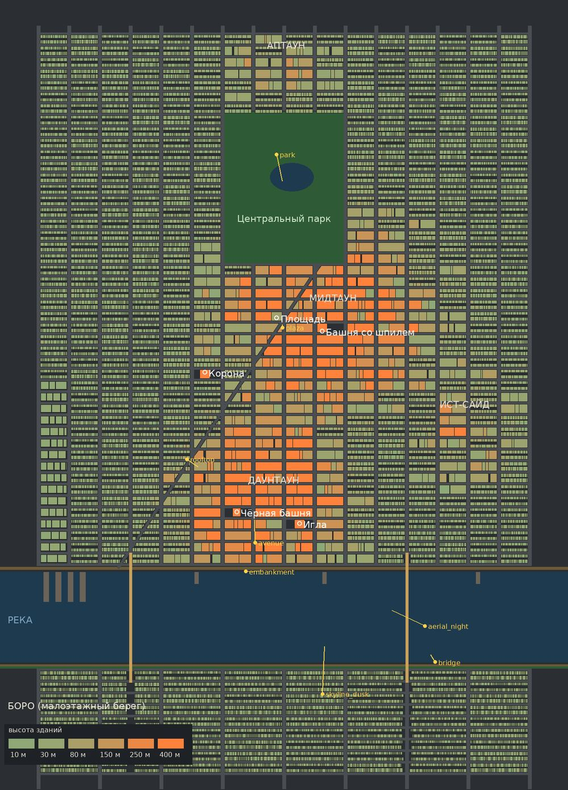

# Город «Метрополис» (`metro-city`)

- **Что это:** постоянный город для всех городских сцен стиля «блендер» (просьба пользователя 26.10.2026: «делай город
  в таком стиле, но чтобы это не было просто картинка сзади а продумай логику построения города и в дальнейшем
  используй данный город, все модели загрузи в гитхаб и бери оттуда»). Это не ролик, а декорация: в роликах снимаем её.
- **Референсы:** `styles/blender/refs/city-night-water.jpg` (ночной мегаполис у воды, поток фар по набережной) и
  `styles/blender/refs/city-dusk-skyline.jpg` (сумеречный скайлайн в дымке, неон, висячий мост).
- **Статус:** v1 в работе, пробные кадры выкладываются пользователю в тред по этапам.



## Как устроен город (логика, а не фон)

Всё строится кодом по плану, один и тот же `SEED` всегда даёт тот же город (`blender/library/metro_plan.py`).
x — восток, y — север, метры.

- **Река** шириной 700 м с востока на запад. Северный берег — город, южный — малоэтажный район **Боро**.
- Вдоль северного берега: прогулочная набережная (0–14 м) с фонарями и шестиполосное **шоссе** с разделителем и
  высокими двойными фонарями (на нём ночью поток фар, как на первом референсе).
- **Сетка:** проспекты с юга на север через 240 м (32 м между фасадами), улицы с запада на восток через 90 м (20 м).
  Квартал ≈ 208 × 70 м. **Диагональный проспект** режет сетку от набережной до парка: клиновидные дома и
  **площадь с экранами** там, где он пересекает центральный проспект.
- **Высоты по цене земли:** два кластера башен — **Даунтаун** у воды и **Мидтаун** у башни со шпилем, между ними
  «долина» пониже, вокруг кирпичные дома, на западе склады и причалы, за рекой таунхаусы.
- **Участки как в настоящих кварталах:** башня занимает весь квартал с подиумом на красной линии, средние дома стоят
  узкими участками фасадом на улицу с дворами сзади, угловые выше.
- **Ориентиры:** «Игла» 520 м, «Чёрная башня» из девяти труб 442 м, «Башня со шпилем» 443 м, «Корона» 320 м.
- **Центральный парк** с озером, **два висячих моста** по осям проспектов («Старый» x = −1200, «Новый» x = 960).
- За краем плана город продолжается рядами кварталов до горизонта и тонет в дымке.

Цифры v1: 15 876 зданий (217 выше 150 м), 764 квартала, 102 дороги; сцена ≈ 0,85–1,05 млн граней, сборка 7–9 с.

## Модули (`blender/library/`, в проект копировать плоско в `blender/sets/`)

| модуль | что делает |
|---|---|
| `metro_plan.py` | план города, чистый Python без bpy; `python3 metro_plan.py --map map.png` рисует карту |
| `metro_mats.py` | материалы: окна шейдером по UV (горит/не горит, шторы, жалюзи, тёплый и холодный свет), износ стен, витрины с полками, асфальт с пятнами фонарей, нарисованный поток машин для дальних улиц, вода, газон, экраны; общий узел `MetroGlobals` (время суток для всего города сразу) и дымка `MetroFog` внутри каждого материала |
| `metro_build.py` | геометрия: дома по ярусам с уступами, карнизы, баки на крышах, кондиционеры, антенны, шпили, красные огни; улицы с разметкой и фонарями, тротуары с бордюром, набережные, причалы, мосты с тросами и огнями, парк, экраны, город за горизонтом |
| `metro_detail.py` | улица вблизи камеры (до 300 м): подоконники и карнизы этажей, пожарные лестницы, балконы, вывески (часть на кириллице), маркизы, двери, крыльца, рёбра стеклянных башен; деревья в лунках, парковка, едущие машины, светофоры, зебры, урны, гидранты, вход в метро с «М», ночью настоящие фонари |
| `metro.py` | сцена для `build_pc.py`: точки съёмки, время суток, движение камеры, отражение реки |

## Как снимать город в ролике

В `blender/shots.json` ролика:

```json
{"id": "s3", "set": "metro", "variant": "skyline_dusk", "dur": 3.2, "move": [-20, 15, 0]}
```

- `variant` — точка съёмки: `skyline_dusk` (скайлайн через реку), `aerial_night` (ночь с высоты над набережной),
  `avenue` (тротуар проспекта днём), `plaza` (площадь с экранами ночью), `embankment` (набережная на закате),
  `bridge` (Новый мост с набережной Боро), `park` (из парка на Мидтаун), `rooftop` (с крыши на даунтаун).
- Своя камера: `"cam": [x, y, z], "target": [x, y, z], "lens": 30` (координаты по карте).
- `preset`: `day`, `golden`, `dusk`, `night`; точечно — `"over": {"lit": 0.4, "fog": "#..."}`.
- `move` — сдвиг камеры за сцену в метрах (цель сдвигается на 30 % от него). `detail_r` — радиус деталей улицы
  (по умолчанию 300 м, если камера ниже 30 м). `"filler": false` — без города за краем плана.

Файлы для ПК: `metro.py`, `metro_plan.py`, `metro_mats.py`, `metro_build.py`, `metro_detail.py` из `blender/library/`
и `lib.py` из `blender/kit/blender/` — в `blender/sets/` (lib — рядом с `build_pc.py`). Здесь же `build_pc.py`
находит их и прямо в репозитории.

## Скорость (ПК, RTX 3060, Eevee, 1080×1920)

- Сборка сцены 7–9 с.
- Стоп-кадр с 64 сэмплами 4–6 с; первый кадр дольше (компиляция шейдеров ~20 с).

## Структура

```
metro-city/
  README.md        этот файл
  map.jpg          карта v1
  blender/         build_pc.py (ищет модули в репозитории), shots.json со всеми точками съёмки
  tools/mkjob.py   задачи для воркера: still / clip / clip60
  jobs/            .ps1 по номерам (330 — первые 8 кадров, 331–332 — второй прогон и клипы)
  qa/              заметки по проверке
```

## Журнал версий

- 26.10.2026 — план и карта (этап 1); дома, улицы, мосты, парк (этап 2); все 8 точек в облаке (этап 3); первый прогон
  на ПК в Eevee: 8 кадров за 2 минуты. Правки по кадрам: плотнее скайлайн (217 башен выше 150 м), фары точками,
  тёплые окна дома и холодные в офисах, витрины с полками, шторы и жалюзи в окнах, износ стен, рёбра у стеклянных
  башен, деревья с настоящей кроной у камеры.
